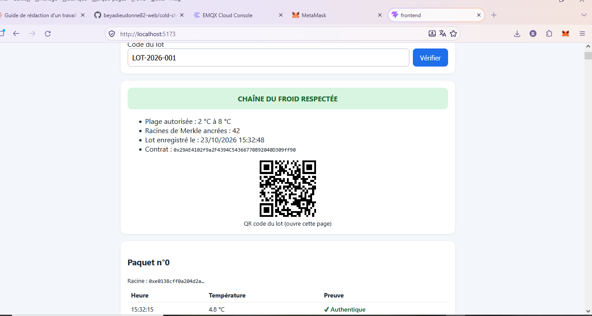
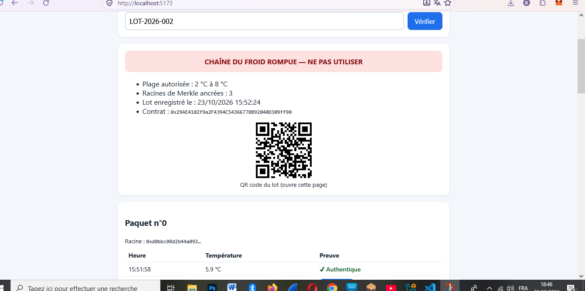
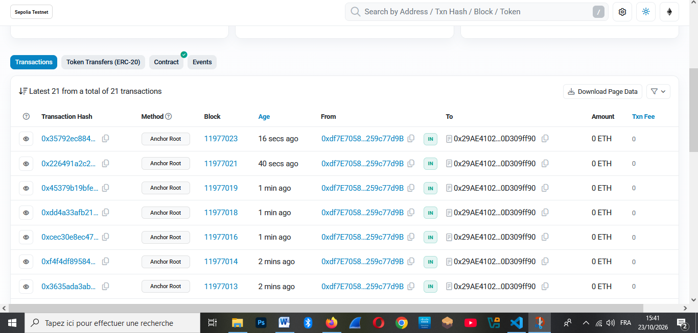
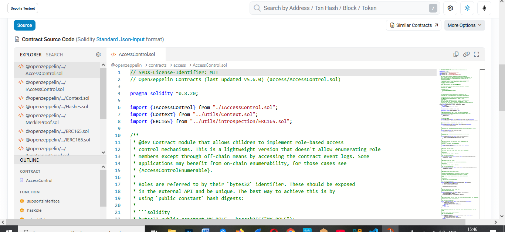
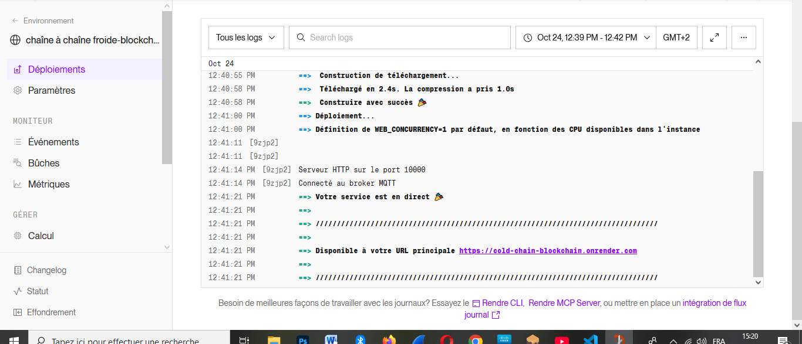
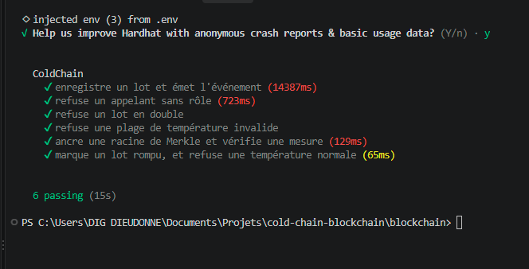

# Traçabilité de la chaîne du froid des médicaments et vaccins

## Université de Kinshasa (UNIKIN)
**Faculté des Sciences et Technologies**  
**Département de Mathématiques, Statistiques et Informatique**

**Niveau :** Master 1  
**Cours :** Blockchain et cryptomonnaie  
**Professeur :** KASENGEDIA  
**Encadrement :** Doctorant Junior Kaningini  
**Groupe 08 :** Blockchain et Internet des objets  
**Année académique :** 2025-2026

### Membres du groupe

| N° | Nom et prénom |
|---:|---|
| 1 | BEYA KADIMA Dieudonne |
| 2 | LUWAWA NAMATA Glody |
| 3 | NKONGOLO NTUMBA TELPH |
| 4 | MUAKA DI MUAKA MARDOCHE |

---

## 1. Présentation et objectifs du projet

Ce projet consiste à concevoir et à développer un système de traçabilité de la chaîne du froid des médicaments et des vaccins à l'aide de la technologie Blockchain et de l'Internet des objets (IoT).

L'objectif principal est de garantir l'intégrité et la traçabilité des informations relatives aux températures enregistrées pendant le transport et le stockage des produits pharmaceutiques.

Le système permet notamment de vérifier si un lot de médicaments ou de vaccins a été conservé dans les conditions de température qui lui sont applicables et de permettre à une pharmacie de consulter ces informations à partir d'une application décentralisée (DApp).

### Objectifs spécifiques

Le prototype permet de :

- Simuler des capteurs de température à l'aide du langage Python.
- Signer cryptographiquement chaque mesure afin de garantir son authenticité.
- Transmettre les mesures par le protocole MQTT sécurisé (TLS).
- Regrouper périodiquement les mesures en paquets.
- Construire un arbre de Merkle pour garantir l'intégrité des données.
- Ancrer les racines de Merkle sur la blockchain Ethereum.
- Détecter et signaler les ruptures de la chaîne du froid.
- Permettre la vérification des lots par une pharmacie grâce à une DApp et à un QR code.

## 2. Liens et ressources du projet

| Élément | Adresse |
|---|---|
| Application décentralisée (DApp) | https://cold-chain-blockchain-frontend.vercel.app |
| Dépôt GitHub | https://github.com/beyadieudonne82-web/cold-chain-blockchain |
| Contrat intelligent ColdChain | [Consulter sur Etherscan](https://sepolia.etherscan.io/address/0x29AE4102f9a2F4394C54366770B92040D309ff90) |
| Collecteur de données | https://cold-chain-blockchain.onrender.com |
| API des paquets de mesures | https://cold-chain-blockchain.onrender.com/batches |

**Réseau blockchain utilisé : Ethereum Sepolia (réseau de test).**

Le sujet initial mentionnait Polygon Amoy. Cependant, pour des raisons liées aux contraintes d'approvisionnement en jetons de test et aux conditions de réalisation du projet, Ethereum Sepolia a été retenu.

Le contrat intelligent est déployé sur Sepolia. Une migration vers Polygon Amoy reste envisageable en adaptant la configuration et en redéployant le contrat.

### Remarques sur les services

- Le collecteur utilise l'offre gratuite de Render. Il peut être mis en veille après une période d'inactivité. La première requête peut donc prendre environ une minute.
- MetaMask est utilisé pour les interactions nécessitant un portefeuille.
- La consultation publique des informations d'un lot ne nécessite pas obligatoirement une connexion MetaMask.
- Les domaines Vercel peuvent afficher un avertissement de sécurité de MetaMask lors de leur première utilisation.

## 3. Architecture technique du système

Le système repose sur quatre composants principaux : les capteurs IoT, le broker MQTT, le collecteur de données, le contrat intelligent et l'application décentralisée.

### 3.1. Schéma architectural

```text
       CAPTEUR SIMULÉ (PYTHON)
       Mesure de température
       Signature cryptographique
                 |
                 |
              MQTT/TLS
                 |
                 v
          EMQX CLOUD
           Broker MQTT
                 |
                 v
       COLLECTEUR NODE.JS
              (Render)
                 |
       Vérification des signatures
       Regroupement des mesures
       Construction de Merkle
                 |
                 v
        CONTRAT INTELLIGENT
        ColdChain (Ethereum)
             Sepolia
                 |
          Racines de Merkle
          État des lots
          Vérification des preuves
                 |
                 v
          DAPP REACT (Vercel)
                 |
             MetaMask
                 |
          PHARMACIE / UTILISATEUR
          Vérification par QR code
```

### 3.2. Fonctionnement général

1. Le capteur simulé collecte périodiquement une température.
2. Chaque mesure est associée à un horodatage et à un identifiant de lot.
3. Le capteur génère une empreinte cryptographique et signe la mesure.
4. Les données sont transmises au collecteur par MQTT avec TLS.
5. Le collecteur vérifie les signatures et regroupe les mesures.
6. Il construit un arbre de Merkle et calcule sa racine.
7. La racine est enregistrée sur Ethereum Sepolia à travers le contrat intelligent.
8. La DApp permet à un utilisateur de consulter les informations du lot et de vérifier les preuves d'intégrité.

### 3.3. Données enregistrées sur la blockchain

Les informations suivantes sont enregistrées sur la blockchain :

- L'identifiant cryptographique du lot.
- Les limites minimale et maximale de température.
- Les racines de Merkle des paquets de mesures.
- L'état de conformité ou de rupture de la chaîne du froid.
- Les informations nécessaires à la vérification des preuves.

### 3.4. Données conservées hors blockchain

Les données suivantes sont conservées par le collecteur :

- Les mesures brutes de température.
- Les horodatages.
- Les signatures des capteurs.
- Les feuilles et les preuves de Merkle.
- Les informations détaillées des paquets.

Le fichier utilisé pour conserver les paquets est :

`collector/data/batches.json`

### 3.5. Utilité de l'arbre de Merkle

L'arbre de Merkle permet de regrouper plusieurs mesures dans une structure cryptographique unique.

Chaque mesure constitue une feuille de l'arbre. Les feuilles sont combinées progressivement pour produire une racine de Merkle.

Cette racine est ensuite enregistrée sur la blockchain.

L'avantage est de ne pas enregistrer chaque mesure individuellement sur la blockchain, ce qui permet de réduire les coûts en gas tout en conservant la possibilité de vérifier l'intégrité d'une mesure particulière.

## 4. Catalogue des médicaments et plages de température

Le système intègre un catalogue de différents types de produits pharmaceutiques.

| Type de produit | Température minimale | Température maximale |
|---|---:|---:|
| Vaccin | 2 °C | 8 °C |
| Insuline | 2 °C | 8 °C |
| Antibiotique (exemple) | 15 °C | 25 °C |
| Vaccin congelé (exemple) | -25 °C | -15 °C |

Ces valeurs sont des paramètres de démonstration du prototype. Les conditions réelles de conservation doivent toujours être définies selon les recommandations du fabricant et les exigences applicables à chaque produit.

Le système compare les températures enregistrées avec les limites configurées pour chaque lot.

Lorsqu'une température dépasse les limites autorisées, le système peut signaler une rupture de la chaîne du froid.

## 5. Structure du dépôt GitHub

Le projet est organisé en plusieurs dossiers :

| Dossier | Description |
|---|---|
| `blockchain/` | Contrat intelligent Solidity, tests Hardhat et scripts de déploiement. |
| `iot/` | Simulateur de capteur Python, génération des mesures et signatures cryptographiques. |
| `collector/` | Collecteur Node.js, communication MQTT, vérification des signatures et construction des arbres de Merkle. |
| `frontend/` | Application décentralisée React avec Vite. |
| `docs/` | Rapports techniques et captures d'écran du projet. |

## 6. Technologies, bibliothèques et services utilisés

### 6.1. Technologies principales

| Technologie | Utilisation |
|---|---|
| Solidity | Développement du contrat intelligent. |
| Ethereum Sepolia | Réseau blockchain de test. |
| Python | Simulation des capteurs IoT. |
| Node.js | Développement du collecteur. |
| React | Interface utilisateur de la DApp. |
| Vite | Environnement de développement frontend. |
| MQTT | Transmission des mesures. |
| TLS | Sécurisation des communications. |
| Merkle Tree | Vérification de l'intégrité des données. |

### 6.2. Bibliothèques utilisées

- OpenZeppelin Contracts : `AccessControl`, `ReentrancyGuard`, `MerkleProof`.
- Hardhat : compilation, tests et déploiement du contrat.
- ethers.js : interaction avec la blockchain.
- merkletreejs : construction des arbres de Merkle.
- MQTT.js : communication MQTT côté collecteur.
- paho-mqtt : communication MQTT côté capteur Python.
- eth-account : gestion des comptes et signatures cryptographiques.
- eth-utils : fonctions cryptographiques.
- dotenv : gestion des variables d'environnement.
- React : développement de l'interface utilisateur.
- qrcode.react : génération des QR codes.
- Slither : analyse statique du contrat intelligent.

### 6.3. Services externes

- EMQX Cloud : broker MQTT.
- Alchemy : fournisseur d'accès RPC Ethereum.
- Etherscan : consultation des transactions et du contrat.
- Render : hébergement du collecteur.
- Vercel : hébergement de la DApp.
- MetaMask : connexion au portefeuille Ethereum.

## 7. Installation et lancement en environnement local

### 7.1. Prérequis

Avant l'installation, il faut disposer des éléments suivants :

- Node.js version 20 ou supérieure.
- npm.
- Python 3.
- Git.
- MetaMask.
- Un accès à Ethereum Sepolia.
- Un compte et une configuration MQTT sur EMQX Cloud.

### 7.2. Configuration des variables d'environnement

Chaque composant possède un fichier `.env.example`.

Il faut copier ce fichier vers `.env`, puis renseigner les variables nécessaires.

Les clés privées, mots de passe et autres informations confidentielles ne doivent jamais être publiés sur GitHub.

### 7.3. Installation du contrat intelligent

Dans un premier terminal :

```bash
cd blockchain
npm install
npx hardhat test
```

### 7.4. Démarrage du collecteur

Dans un deuxième terminal :

```bash
cd collector
npm install
node index.js
```

Le collecteur doit être configuré avec les informations de connexion au broker MQTT et les paramètres blockchain nécessaires.

### 7.5. Démarrage du capteur IoT

Dans un troisième terminal :

```powershell
cd iot
python -m venv venv
.\venv\Scripts\Activate.ps1
pip install paho-mqtt eth-account python-dotenv
```

Pour lancer le capteur :

```bash
python sensor.py
```

Pour simuler une rupture de la chaîne du froid :

```bash
python sensor.py --breach
```

Les paramètres du lot et du type de médicament peuvent être configurés dans les variables d'environnement `LOT_NAME` et `MEDICINE`.

### 7.6. Démarrage de la DApp

Dans un quatrième terminal :

```bash
cd frontend
npm install
npm run dev
```

L'application est alors accessible à l'adresse locale fournie par Vite, généralement :

`http://localhost:5173`

## 8. Déploiement

### 8.1. Déploiement du contrat intelligent

Depuis le dossier `blockchain` :

```bash
npx hardhat run scripts/deploy.js --network sepolia
```

Pour vérifier le contrat sur Etherscan :

```bash
npx hardhat verify --network sepolia ADRESSE_DU_CONTRAT
```

### 8.2. Déploiement du collecteur

Le collecteur est hébergé sur Render.

Le dossier racine du service est :

`collector/`

Les variables d'environnement nécessaires sont configurées directement dans les paramètres du service Render.

### 8.3. Déploiement de la DApp

L'application frontend est hébergée sur Vercel.

Le dossier racine du projet est :

`frontend/`

Les paramètres de connexion au contrat et au collecteur doivent être correctement configurés dans les variables d'environnement de Vercel.

## 9. Tests et sécurité

### 9.1. Tests automatisés

Le contrat intelligent a fait l'objet de six tests automatisés avec Hardhat.

Les scénarios couverts comprennent :

1. L'enregistrement d'un lot.
2. Le contrôle des accès.
3. La détection des lots en double.
4. Le rejet d'une plage de température invalide.
5. L'ancrage d'une racine de Merkle.
6. La vérification des preuves de Merkle valides et falsifiées ainsi que le signalement d'une rupture de la chaîne du froid.

### 9.2. Analyse statique avec Slither

Une analyse statique a été réalisée avec Slither version 0.11.6.

| Indicateur | Résultat |
|---|---:|
| Détecteurs utilisés | 102 |
| Contrats analysés | 10 |
| Alertes signalées | 0 |

L'absence d'alerte ne constitue pas une garantie absolue de sécurité. Le contrat n'a pas fait l'objet d'un audit professionnel indépendant.

### 9.3. Mesures de sécurité appliquées

- Contrôle d'accès basé sur les rôles.
- Protection contre la réentrance.
- Validation des entrées.
- Utilisation d'erreurs personnalisées.
- Émission d'événements pour assurer la traçabilité.
- Utilisation de signatures cryptographiques.
- Conservation des données sensibles hors blockchain.
- Utilisation de communications MQTT sécurisées par TLS.

## 10. Analyse des coûts en gas

Les mesures de consommation de gas ont été réalisées avec Hardhat, Solidity 0.8.28 et l'optimiseur activé avec 200 exécutions.

| Opération | Consommation moyenne en gas | Nombre d'appels dans les tests |
|---|---:|---:|
| Déploiement de `ColdChain` | 1 044 771 | 1 |
| `registerLot` | 78 266 | 5 |
| `anchorRoot` | 121 137 | 1 |
| `flagBreach` | 34 996 | 2 |
| `grantRole` | 51 485 | 1 |

L'ancrage d'une racine de Merkle permet de représenter un paquet entier de mesures, au lieu d'enregistrer chaque mesure séparément sur la blockchain.

Cette approche contribue à réduire le nombre de transactions et les coûts de stockage.

Le coût réel en ETH dépend du prix du gas au moment de l'exécution des transactions.

## 11. Tokenomics

Le projet n'utilise aucun jeton numérique spécifique.

Il ne prévoit :

- Aucune émission de cryptomonnaie.
- Aucune vente de jetons.
- Aucune promesse de rendement financier.

Les ETH utilisés sur Sepolia sont uniquement des jetons de test sans valeur monétaire réelle.

## 12. Menaces, limites et perspectives d'amélioration

Malgré les mécanismes de sécurité mis en place, le prototype présente certaines limites.

### 12.1. Limites techniques

**Fiabilité des capteurs :** un capteur compromis peut transmettre de fausses mesures, même si celles-ci sont correctement signées. La blockchain garantit l'intégrité des données enregistrées, mais pas leur exactitude physique.

**Simulation des capteurs :** les capteurs utilisés sont simulés en Python. Une mise en production nécessiterait des équipements physiques certifiés et des clés cryptographiques protégées.

**Gestion des rôles :** le prototype utilise un nombre limité de comptes. Une production réelle devrait séparer les responsabilités entre fabricants, transporteurs, collecteurs et pharmacies.

**Stockage hors chaîne :** les mesures et les preuves sont conservées par le collecteur dans un fichier JSON. L'offre gratuite de Render peut utiliser un stockage temporaire. Les données peuvent donc être perdues lors d'un redémarrage si aucun stockage persistant n'est configuré.

**Dépendance au collecteur :** la consultation détaillée des mesures dépend de la disponibilité du serveur qui fournit les preuves de Merkle.

**Réseau de test :** le système utilise Ethereum Sepolia et ne constitue pas encore une solution de production.

### 12.2. Perspectives d'amélioration

Pour améliorer le système, plusieurs évolutions sont envisageables :

- Intégration de capteurs physiques certifiés.
- Utilisation d'un stockage persistant avec une base de données.
- Éventuellement, intégration d'IPFS pour le stockage décentralisé.
- Séparation des rôles et amélioration de la gestion des autorisations.
- Audit professionnel du contrat intelligent.
- Déploiement sur un réseau blockchain de production.
- Renforcement de la sécurité des clés cryptographiques.
- Respect des réglementations pharmaceutiques applicables.

## 13. Données de démonstration

Toutes les données utilisées dans le prototype sont fictives et synthétiques.

### 13.1. Lots de démonstration

| Identifiant du lot | Scénario |
|---|---|
| `LOT-2026-001` | Lot conforme à la plage autorisée. |
| `LOT-2026-002` | Lot présentant une rupture de la chaîne du froid. |

Les lots supplémentaires, notamment les exemples d'insuline et de vaccin congelé, permettent d'illustrer le catalogue et les paramètres de température. Leur disponibilité complète dans les tableaux de mesures dépend de la présence des paquets correspondants dans le collecteur.

### 13.2. Adresses blockchain

**Adresse du contrat intelligent :**

`0x29AE4102f9a2F4394C54366770B92040D309ff90`

**Adresse du compte de déploiement Sepolia :**

`0xdf7E70581c9aE16C34A6752C0af7528259c77d9B`

**Adresse du capteur simulé :**

`0x0572A79098B1FA9d417d5744f52E115A3760418f`

Aucune clé privée n'est publiée dans le dépôt.

## 14. Captures d'écran et illustrations

Les captures suivantes permettent de présenter les différentes parties du prototype.

### DApp : lot conforme


### DApp : lot avec rupture de la chaîne du froid


### Transactions sur Etherscan


### Contrat intelligent vérifié


### Collecteur en ligne sur Render


### Résultats des tests Hardhat


> **Important :** Pour que ces visuels s'affichent, assurez-vous d'avoir bien créé un dossier nommé `docs` à la racine de votre projet GitHub et d'y avoir téléversé (uploadé) vos fichiers images avec les noms exacts (ex: `dapp-conforme.png`).

## 15. Licence

Ce projet est distribué sous licence MIT.

---

**Université de Kinshasa (UNIKIN)**  
**Faculté des Sciences et Technologies**  
**Département de Mathématiques, Statistiques et Informatique**

**Master 1 – Blockchain et cryptomonnaie**  
**Groupe 08 – Blockchain et Internet des objets**  
**Année académique : 2025-2026**

*Projet académique réalisé dans le cadre du cours de Blockchain et cryptomonnaie.*