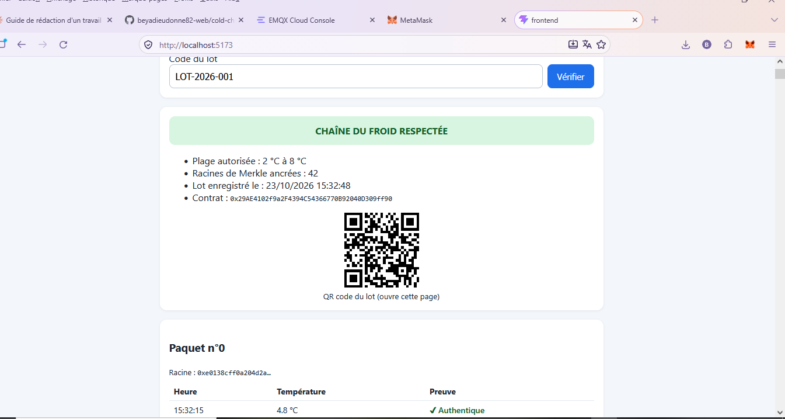
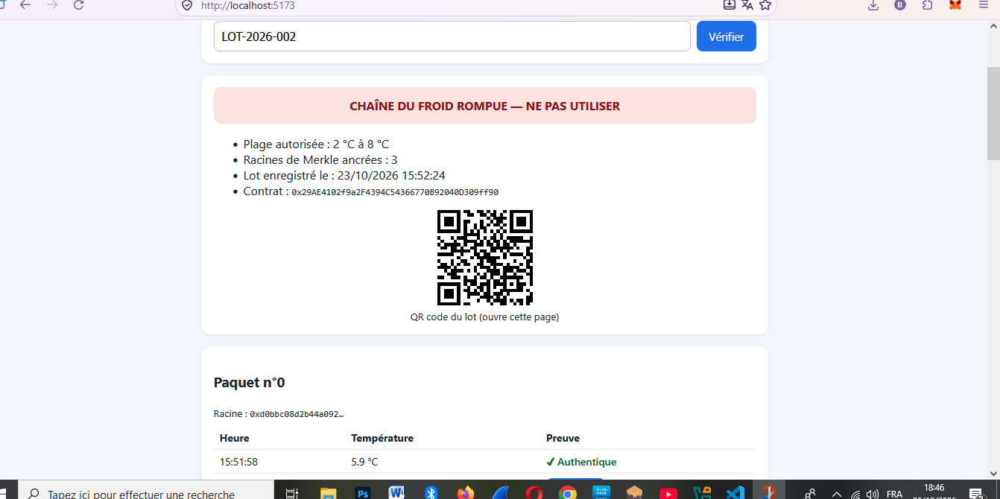
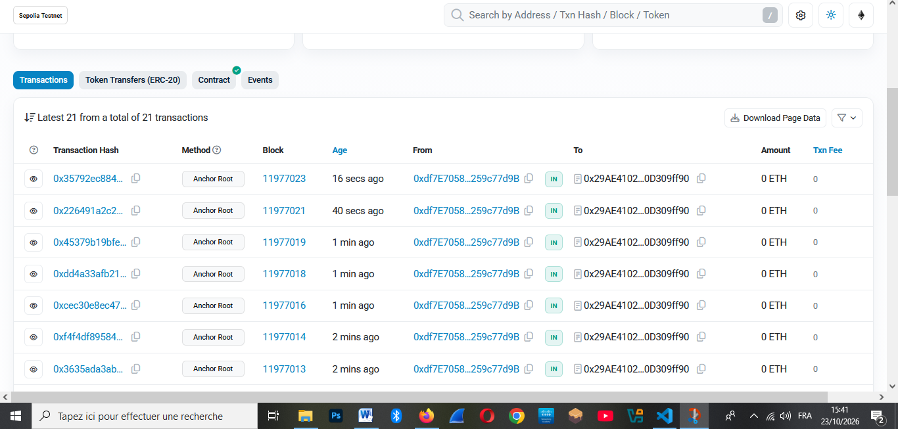
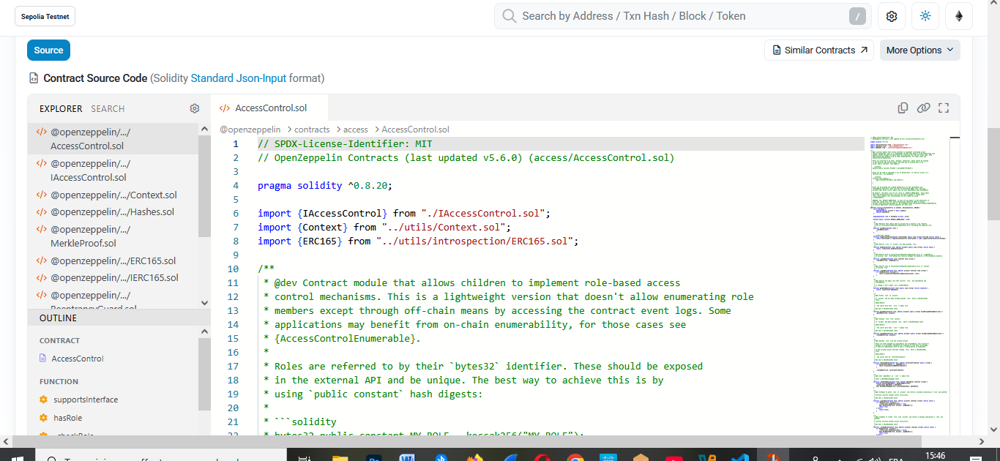
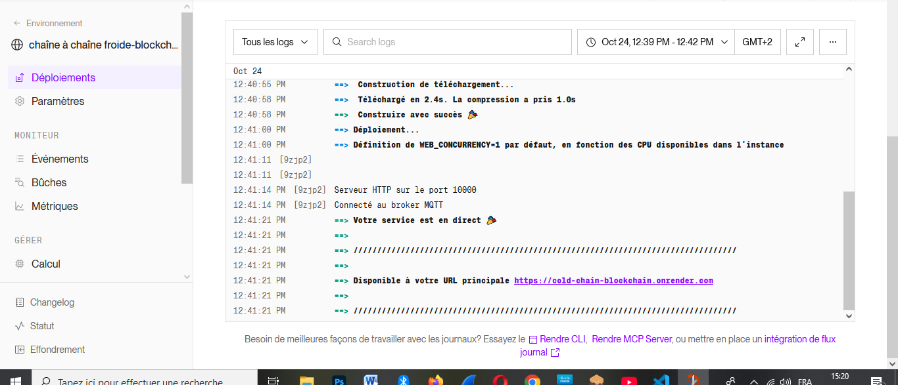
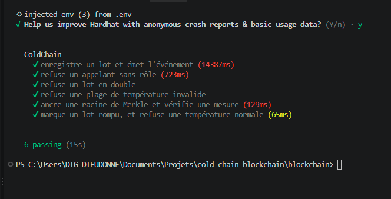

# Traçabilité de la chaîne du froid des médicaments et vaccins

#

**Université de Kinshasa (UNIKIN)**
**Faculté des Sciences et Technologies**
**Département de Mathématiques, Statistiques et Informatique**
Master 1 : cours de Blockchain et cryptomonnaie

PROF : KASENGEDIA, 

Doctorant: Junior Kaningini

Groupe 08 : Blockchain et Internet des objets
Année académique : 2025-2026

| Membres |
|---|
| BEYA KADIMA Dieudonne |
| LUWAWA NAMATA Glody
| NKONGOLO NTUMBA TELPH
  MUAKA DI MUAKA MARDOCHE

## 1. Objectifs
Garantir qu'un lot de médicaments ou de vaccins est resté dans la plage de température autorisée (2,0 à 8,0 °C) pendant son transport, et permettre à une pharmacie de le vérifier elle-même.

Le prototype :
- simule des capteurs de température qui **signent** chaque mesure ;
- **ancre périodiquement** sur la blockchain la racine de Merkle des mesures de chaque lot ;
- **marque** un lot dont la chaîne du froid a été rompue ;
- permet la **vérification par la pharmacie** via un QR code et une DApp.

## 2. Liens de remise
| Élément | Lien |
|---|---|
| DApp déployée | https://cold-chain-blockchain-frontend.vercel.app |
| Dépôt GitHub | https://github.com/beyadieudonne82-web/cold-chain-blockchain |
| Contrat `ColdChain` (Sepolia) | https://sepolia.etherscan.io/address/0x29AE4102f9a2F4394C54366770B92040D309ff90 |
| Collecteur (Render) |: adresse https://cold-chain-blockchain.onrender.com |

**Réseau utilisé : Ethereum Sepolia.** Le sujet mentionnait Polygon Amoy, mais ses faucets exigent des fonds réels sur le mainnet, ce qui est interdit par les règles du projet. Ethereum Sepolia figure parmi les réseaux de test autorisés. Le contrat se redéploie sur Amoy en changeant uniquement la configuration Hardhat.

Remarques :
- Le collecteur utilise l'offre gratuite de Render : il s'endort après inactivité, et la première requête peut prendre environ une minute.
- MetaMask peut afficher un avertissement sur les domaines récents `vercel.app`. La vérification d'un lot fonctionne **sans connexion** ; la connexion MetaMask est démontrée dans les captures.

## 3. Architecture

```text
Capteur simulé (Python)  --MQTT/TLS-->  EMQX Cloud (broker)
                                              |
                                              v
                                  Collecteur Node.js (Render)
                  vérifie la signature, regroupe par paquets de 10,
                  construit l'arbre de Merkle, appelle le contrat
                                              |
                                              v
                          Contrat ColdChain (Ethereum Sepolia)
                                              ^
                                              | lecture + vérification des preuves
                                     DApp React (Vercel) + MetaMask
```

**Sur la chaîne :** enregistrement des lots (hash du produit, plage de température), racines de Merkle ancrées, état « rompu » d'un lot, vérification d'une preuve de Merkle.

**Hors chaîne :** mesures brutes, signatures des capteurs, preuves de Merkle (fichier `collector/data/batches.json`).

**Pourquoi la racine de Merkle ?** Ancrer une seule racine par paquet de mesures coûte bien moins de gas que d'écrire chaque mesure, tout en permettant de prouver qu'une mesure précise appartient au paquet.

## 4. Structure du dépôt
| Dossier | Contenu |
|---|---|
| `blockchain/` | Contrat Solidity, tests Hardhat, script de déploiement |
| `iot/` | Simulateur de capteur Python (signature des mesures, publication MQTT) |
| `collector/` | Collecteur Node.js (MQTT, signatures, Merkle, ancrage) |
| `frontend/` | DApp React (Vite) |
| `docs/` | Rapport Slither, captures d'écran |

## 5. Bibliothèques et ressources réutilisées
OpenZeppelin Contracts (`AccessControl`, `ReentrancyGuard`, `MerkleProof`), Hardhat, ethers.js, merkletreejs, MQTT.js, paho-mqtt, eth-account, dotenv, React, Vite, qrcode.react, Slither. Services : EMQX Cloud (MQTT), Alchemy (nœud RPC), Etherscan, Render, Vercel.

## 6. Installation et lancement en local
Prérequis : Node.js 20+, Python 3, MetaMask.

Chaque dossier possède un `.env.example` à copier en `.env` et à remplir. Aucun secret n'est publié.

```bash
# Contrat
cd blockchain
npm install
npx hardhat test

# Collecteur
cd ../collector
npm install
node index.js

# Capteur (autre terminal)
cd ../iot
python -m venv venv
.\venv\Scripts\Activate.ps1
pip install paho-mqtt eth-account python-dotenv
python sensor.py            # ou : python sensor.py --breach

# DApp (autre terminal)
cd ../frontend
npm install
npm run dev
```

## 7. Déploiement
```bash
cd blockchain
npx hardhat run scripts/deploy.js --network sepolia
npx hardhat verify --network sepolia <adresse du contrat>
```
Le collecteur est déployé sur Render (dossier racine `collector`) et la DApp sur Vercel (dossier racine `frontend`), avec les variables d'environnement documentées dans les fichiers `.env.example`.

## 8. Tests et sécurité
- **6 tests automatisés Hardhat** : enregistrement d'un lot, contrôle d'accès, lot en double, plage invalide, ancrage et preuve de Merkle (valide et falsifiée), signalement d'une rupture.
- **Slither 0.11.6** : 102 détecteurs, 10 contrats analysés, **0 alerte**.
- **Bonnes pratiques appliquées** : contrôle d'accès par rôles, protection contre la réentrance, validation des entrées avec erreurs personnalisées, événements pour la traçabilité, aucune donnée personnelle sur la chaîne (seulement des hash).
- Une analyse automatique ne garantit pas l'absence de toute faille, et le contrat n'a pas fait l'objet d'un audit professionnel.

## 9. Coûts en gas

Mesures réalisées avec Hardhat (Solidity 0.8.28, optimiseur activé, 200 exécutions) à partir des tests automatisés. Le coût réel en ETH dépend du prix du gas au moment de la transaction.

| Opération | Gas (moyenne) | Appels dans les tests |
|---|---|---|
| Déploiement de `ColdChain` | 1 044 771 (1,7 % de la limite de bloc) | 1 |
| `registerLot` | 78 266 | 5 |
| `anchorRoot` | 121 137 | 1 |
| `flagBreach` | 34 996 | 2 |
| `grantRole` | 51 485 | 1 |

L'ancrage d'une seule racine de Merkle (environ 121 000 gas) couvre un paquet entier de 10 mesures : écrire chaque mesure séparément serait plus coûteux.
## 10. Tokenomics
Le projet n'utilise **aucun jeton** : pas de cryptomonnaie, pas de vente, pas de promesse de rendement.

## 11. Menaces et limites
- Un capteur compromis peut signer de fausses mesures : la blockchain prouve l'intégrité des données, pas leur exactitude physique (problème de l'« oracle »).
- Les capteurs sont simulés ; en production, il faudrait des capteurs certifiés avec clés protégées par du matériel sécurisé.
- Un seul compte joue le rôle d'administrateur et de collecteur ; en production, séparer les rôles et utiliser un portefeuille matériel ou multi-signature.
- Les preuves sont servies par un collecteur à stockage temporaire (offre gratuite de Render) ; en production, base de données persistante ou stockage décentralisé (IPFS).
- Réseau de test uniquement, jetons sans valeur.

## 12. Feuille de route vers la production
1. Audit externe du contrat.
2. Capteurs réels avec identité matérielle sécurisée.
3. Rôles séparés (fabricant, transporteur, pharmacie) et multi-signature.
4. Stockage persistant ou IPFS pour les preuves.
5. Déploiement sur un réseau de production à faibles frais (Polygon ou Base).
6. Conformité réglementaire (bonnes pratiques de distribution pharmaceutique).

## 13. Données de démonstration
Toutes les données sont **fictives et synthétiques**.

| Élément | Valeur |
|---|---|
| Lot conforme | `LOT-2026-001` |
| Lot à chaîne du froid rompue | `LOT-2026-002` |
| Adresse du compte de déploiement (Sepolia) | `0xdf7E70581c9aE16C34A6752C0af7528259c77d9B` |
| Adresse du capteur simulé | `0x0572A79098B1FA9d417d5744f52E115A3760418f` |

Aucune clé privée n'est publiée.

## 14. Captures d'écran
| | |
|---|---|
| DApp, lot conforme |  |
| DApp, lot rompu |  |
| Transactions sur Etherscan |  |
| Contrat vérifié |  |
| Collecteur en ligne |  |
| Tests Hardhat |  |

## 15. Licence
MIT.